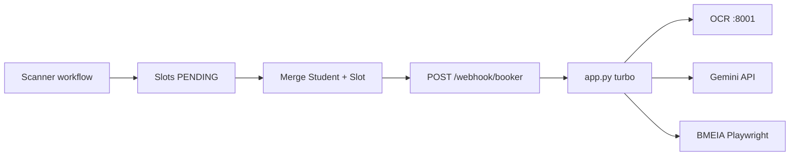

# Agent Handoff — Python Booker Webhook

**Last updated:** 2026-05-31  
**Purpose:** Onboard the next Cursor agent session with accurate project state, decisions, evidence, and open work. Read this before changing captcha, VPS, or n8n integration.

---

## Executive summary

| Area | Status |
|------|--------|
| Turbo booker (`POST /webhook/booker`) | **Working** — scheduler POST + Playwright submit |
| Local dev (Windows) | SUCCESS with OCR or Gemini on easy captchas (~5–6s) |
| VPS production (Docker) | **Working with `gemini_first`** — run `1411570` SUCCESS attempt 1 (~4.8s) |
| n8n integration | Workflow in `workflows/booker.json`; HTTP 300s timeout, serial booking |
| KOPENHAGEN test stand-in | Validated; KAIRO = same code, different payload constants |
| OCR-first on VPS | **Unreliable** — wrong answers + suspected image/answer desync (see §5) |

**Operational recommendation for VPS today:** `CAPTCHA_SOLVER=gemini_first` (or `TURBO_CAPTCHA_SOLVER=gemini_first`), not `ocr_with_gemini_fallback`.

**Code default (repo):** `ocr_with_gemini_fallback` in `app.py` — intentional for cost/latency when OCR is accurate; VPS evidence overrides this until OCR pipeline is fixed.

---

## Architecture (unchanged)



**Two services on VPS:**

| Process | Port | Role |
|---------|------|------|
| `uvicorn app:app` | 8000 | Booker webhook (Playwright) |
| `uvicorn server:app` (captcha_recognition) | 8001 | OCR `/predict` (anuashok-style CRNN) |

**Office-agnostic:** `Office`, `CalendarId`, `sessionCookie` come from n8n payload. Kairo = change constants only.

---

## What was completed (production plan session)

### Code & config

| Change | File |
|--------|------|
| Turbo default solver → `ocr_with_gemini_fallback` | `app.py` |
| `captcha_parallel_fetch_enabled()` default → `false` | `booker_legacy.py` |
| `TURBO_CAPTCHA_SOLVER` documented | `.env`, `.env.example` |
| Regression script DOM vs URL captcha | `scripts/compare_captcha_fetch.py` |

### n8n

| Change | Location |
|--------|----------|
| HTTP timeout 300000 ms | `workflows/booker.json` |
| Body: `runId`, `captureArtifacts`, full student map | same |
| Retry on fail: 2×, 60s wait | same |
| Version control + import notes | `workflows/README.md` |

### Documentation synced

- `docs/TURBO_APP.md`, `docs/CAPTCHA_INVESTIGATION.md`, `docs/n8n-booking-result-flow.md` (§7 Production checklist), `README.md`, `docs/TESTING_KOPENHAGEN.md`

### Validation

- `python -m py_compile` — pass
- Local smoke `prod-smoke-defaults-001` — SUCCESS attempt 1, OCR, ~4.5s, `captchaParallelUsed: false`

---

## VPS deployment (validated configuration)

### Start command

```bash
uvicorn app:app --host 0.0.0.0 --port 8000 --workers 1
```

**Must use `--workers 1`.** Multiple workers caused Playwright sync API errors (`inside the asyncio loop`) and inconsistent behavior across PIDs.

### Recommended `.env` on VPS

```dotenv
# Solver — production choice after live testing
CAPTCHA_SOLVER=gemini_first
# TURBO_CAPTCHA_SOLVER=gemini_first

CAPTCHA_PARALLEL_FETCH=false
CAPTCHA_OCR_ENHANCE=false
CAPTCHA_MAX_STYLE_RELOADS=0
CAPTCHA_KEYSTROKE_DELAY_MS=20
BOTDETECT_SETTLE_MS=150

CAPTCHA_OCR_BASE_URL=http://127.0.0.1:8001
GEMINI_API_KEY=...

PLAYWRIGHT_HEADLESS=true
PLAYWRIGHT_SLOW_MO=0
PLAYWRIGHT_REUSE_BROWSER=false

BOOKING_USE_GLOBAL_LOCK=true
BOOKING_SLOT_WAIT_SEC=15
MAX_CONCURRENT_BOOKINGS=1
```

**Do not use** `PLAYWRIGHT_HEADLESS=false` on Linux Docker without Xvfb (`docs/XVFB_PLAYWRIGHT_DEPLOYMENT.md`).

### Deploy files (minimum)

`app.py`, `booker_legacy.py`, `captcha_ocr.py`, `scheduler_html.py`, `app_turbo.py`, `requirements.txt`, `.env`

**Not on VPS:** `artifacts/`, local `.venv`, test payloads. **n8n gets** `workflows/booker.json` (import in UI, not on booker VPS).

---

## Captcha: confirmed root causes

Full detail: [`docs/CAPTCHA_INVESTIGATION.md`](CAPTCHA_INVESTIGATION.md)

| Issue | Verdict | Fix |
|-------|---------|-----|
| Parallel URL fetch ≠ DOM image | ✅ Proven 0/5 | `CAPTCHA_PARALLEL_FETCH=false` always |
| BotDetect new image on every HTTP GET | ✅ Proven | DOM screenshot only for solving |
| `ocr_with_gemini_fallback` only falls back on OCR **exception** | ✅ By design | Wrong OCR answer → no Gemini; see §5 |
| Hard BotDetect styles | ✅ OCR/Gemini both struggle | Gemini-first on VPS |
| Style-gate reload | ⚠️ Unreliable | Keep `CAPTCHA_MAX_STYLE_RELOADS=0` |
| Hs race attempt 1 | ✅ Fixed | `typeof ct.Captcha !== 'undefined'` in `wait_botdetect_ready` |

**Do not enable `CAPTCHA_PARALLEL_FETCH=true`** until Option B (always solve DOM bytes + SHA256 verify 5/5 in `compare_captcha_fetch.py`).

---

## VPS incident log (2026-05-31)

### 1. Playwright asyncio 500

**Symptom:** `Playwright Sync API inside the asyncio loop`  
**Cause:** Multiple uvicorn workers / wrong thread  
**Fix:** `--workers 1`, `PLAYWRIGHT_HEADLESS=true`, full process restart

### 2. OCR-first CAPTCHA_FAIL loop (run `1411526`, `1411458`)

**Symptom:** OCR returns text, typed correctly (`captchaTextMatchesOcr: true`), submit returns to capture page every time  
**Cause:** OCR model wrong on BotDetect hard/medium styles; Gemini not invoked because OCR did not throw  
**Not fixed in code yet**

### 3. ETIMEDOUT 500 (Nour / run `1411458`)

**Symptom:** `APIRequestContext.post: read ETIMEDOUT` on scheduler POST during attempt 2+  
**Cause:** After CAPTCHA fail, retry path calls `navigate_to_capture_form_via_scheduler_post()` → BMEIA slow + long retry chains  
**Mitigation:** Fewer retries; n8n retry only on 503; fresh `sessionCookie` per booking

### 4. Gemini-first SUCCESS (run `1411570`)

**Evidence:** Hard captcha, attempt 1, `"source": "gemini"`, `resultType: SUCCESS`, ~4.8s  
**Session:** fresh cookie, single pass, no n8n retry overwrite

---

## OCR image / answer desync (open investigation)

User manually verified: **OCR text matches a different captcha PNG** than the artifact saved for that attempt.

### Likely causes (not yet proven in code)

1. **n8n `retryOnFail` + same `runId`** → artifacts `attempt_NN_captcha.png` overwritten on second pass; logs from pass 1 compared to PNGs from pass 2  
2. **Comparing `attempt_NN_captcha.png` to captcha in `attempt_NN_response.html`** — post-fail HTML always has a *new* captcha (expected mismatch)  
3. **OCR service cross-talk** — every request uses filename `captcha.png` to `:8001/predict`; possible stale/swapped responses under load  
4. **Attempt 2+ scheduler re-POST** — heavy `page.set_content()` path vs inline error captcha

### Code facts (single attempt, sync path)

- Same `last_captcha_bytes` → artifact save **and** OCR call (`app.py` ~278–322)  
- Source: `capture_captcha_bytes_from_dom()` when parallel off  
- **No SHA256 / VCID bind** between artifact, OCR request, and submit today

### Recommended code fixes (next agent)

1. Log SHA256 of bytes at capture + OCR send + `vcidTail`  
2. Unique OCR upload filename: `captcha_{runId}_{attempt}_{vcid}.png`  
3. Artifact subdirs per webhook entry (avoid overwrite on n8n retry)  
4. **Gemini after first CAPTCHA_FAIL** or on `difficulty == hard`  
5. Optional: on retry, re-screenshot current page instead of full scheduler re-POST  
6. Optional: `asyncio.to_thread()` wrapper on webhook handlers (VPS hardening)

---

## Solver modes (`app.py`)

| Env value | Behavior |
|-----------|----------|
| `ocr_with_gemini_fallback` | OCR; Gemini only if OCR **throws** (default in code) |
| `gemini_first` | Gemini; OCR if Gemini throws |
| `ocr` / `gemini` | Single solver only |

Override turbo only: `TURBO_CAPTCHA_SOLVER=...`

---

## Key test runs (reference)

| runId | Solver | Parallel | Result | Time | Notes |
|-------|--------|----------|--------|------|-------|
| `prod-smoke-defaults-001` | OCR (local) | off | SUCCESS | ~4.5s | Windows smoke |
| `turbo-dom-only-2698005` | Gemini | off | SUCCESS | ~6.4s | DOM-only proof |
| `turbo-ocr-test-9970733` | OCR | off | SUCCESS | ~5.8s | Local OCR path |
| `turbo-style-gate-5196311` | Gemini | on | FAIL 5/5 | ~70s | Parallel URL wrong image |
| `1411526` | OCR | off | FAIL 10× | — | VPS; n8n retry; OCR wrong/desync |
| `1411570` | Gemini | off | **SUCCESS** | ~4.8s | **VPS production proof** |

Debug log: `debug-ce612b.log` (JSONL, same schema as VPS).

Artifacts: `artifacts/<runId>-turbo/` — `attempt_NN_captcha.png`, `attempt_NN_response.html`.

---

## n8n operational notes

- Import: `workflows/booker.json`  
- URL: user ngrok → VPS `:8000/webhook/booker`  
- **Serial booking** — `One Slot at a Time`; `BOOKING_USE_GLOBAL_LOCK=true`  
- **Retry on fail** currently retries 500/CAPTCHA_FAIL — **bad**; causes double booking attempts and artifact overwrite. Prefer retry **503 only**.  
- Fresh `sessionCookie` per student from scanner — never fan out one cookie  
- Student DB field `bookedSlot` may be stale; workflow uses scanner `currentSlot`

---

## Out of scope (defer)

- Option B parallel fetch code fix  
- Style-gate reload reliability  
- Refactoring `booker_legacy.py` monolith  
- Live Kairo booking (needs scanner `Office: KAIRO` + correct `CalendarId`)  
- Commit/push unless user asks  

---

## Quick commands

```bash
# Health
curl http://127.0.0.1:8000/health

# Local turbo (payload file)
python scripts/run_turbo_payload.py scripts/smoke_prod_defaults_payload.json

# Fresh slot (KOPENHAGEN)
python scripts/scan_slots.py

# Captcha DOM vs URL regression
python scripts/compare_captcha_fetch.py

# Compile check
python -m py_compile app.py booker_legacy.py
```

---

## Doc map

| Doc | Use when |
|-----|----------|
| **[N8N_BOOKER_LOCK_IMPLEMENTATION_PLAN.md](N8N_BOOKER_LOCK_IMPLEMENTATION_PLAN.md)** | Lock + n8n/ngrok integration checklist, test matrix, findings log |
| **[../versions/lock-integration-v1/README.md](../versions/lock-integration-v1/README.md)** | Isolated sandbox: booker-lock + **KOPENHAGEN watcher** E2E, scripts, workflow IDs |
| **This file** | Session handoff / current status |
| [CAPTCHA_INVESTIGATION.md](CAPTCHA_INVESTIGATION.md) | Captcha root-cause history |
| [TURBO_APP.md](TURBO_APP.md) | Turbo env vars and endpoints |
| [n8n-booking-result-flow.md](n8n-booking-result-flow.md) | n8n result types + production checklist |
| [PARALLEL_BOOKING.md](PARALLEL_BOOKING.md) | Workers, locks, 503 behavior |
| [TESTING_KOPENHAGEN.md](TESTING_KOPENHAGEN.md) | Safe test office |
| [XVFB_PLAYWRIGHT_DEPLOYMENT.md](XVFB_PLAYWRIGHT_DEPLOYMENT.md) | Headed Linux |
| [workflows/README.md](../workflows/README.md) | Import booker.json |

---

## First actions for next agent

1. Read this file + skim `CAPTCHA_INVESTIGATION.md` § Current State  
2. Confirm user goal: fix OCR pipeline vs keep `gemini_first` on VPS  
3. If fixing OCR desync: implement SHA256 + unique OCR filenames + artifact naming  
4. If improving fallback: Gemini on CAPTCHA_FAIL or on `hard` difficulty  
5. Tune n8n: disable retry on CAPTCHA_FAIL/500; retry 503 only  
6. Update `README.md` / `CAPTCHA_INVESTIGATION.md` if production solver choice changes  

**Do not edit** `c:\Users\WD\.cursor\plans\production_n8n_integration_01986103.plan.md`.
