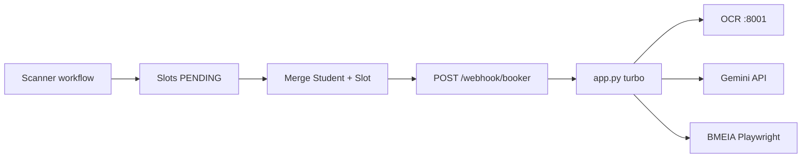

# Agent Handoff — Python Booker Webhook

**Last updated:** 2026-07-13  
**Purpose:** Onboard the next Cursor agent session with accurate project state, decisions, evidence, and open work. Read this before changing captcha, VPS, or n8n integration.

---

## Executive summary

| Area | Status |
|------|--------|
| Turbo booker (`POST /webhook/booker`) | **Working** — scheduler POST + Playwright submit; **no more HTTP 500s** from ValueError crashes |
| Local dev (Windows) | **v1.0.1 pipeline merged** — 5/5 KOPENHAGEN SUCCESS on `:8000` (2026-06-16) |
| Repo captcha pipeline | DOM-only capture, HS guard, Gemini on round ≥ `CAPTCHA_GEMINI_FIRST_AFTER` (default 2), `DomCaptchaCaptureError` |
| Unit/integration tests | **78 passed** (61 unit + 17 integration) |
| VPS production | **Ran with partial fix** (user manually edited app.py — missing the latest refactor) |
| n8n integration | Workflow in `workflows/booker.json`; **no more bare "HTTP request failed"** — all errors return `resultType` JSON |
| KOPENHAGEN test stand-in | Validated; KAIRO = same code, different payload constants |
| OCR finetune (5k dataset) | **In progress** — see `docs/CAPTCHA_OCR_DATASET.md`; deploy weights before VPS OCR-first retest |

**VPS deploy:** `app.py` from this repo must be copied to VPS and uvicorn restarted. See § VPS deploy below.

**Code default (repo):** `CAPTCHA_SOLVER=ocr_with_gemini_fallback`, `CAPTCHA_GEMINI_FIRST_AFTER=2`, `CAPTCHA_MAX_STYLE_RELOADS=0`. Parallel URL fetch **hard-disabled** in code.

---

## Architecture (unchanged)



**Two services on VPS:**

| Process | Port | Role |
|---------|------|------|
| `uvicorn app:app` | 8000 | Booker webhook (Playwright) |
| `uvicorn server:app` (captcha_recognition) | 8001 | OCR `/predict` (anuashok-style CRNN) |

**Office-agnostic:** `Office`, `CalendarId`, `sessionCookie` come from n8n payload. Kairo = change constants only.

---

## What was completed (2026-07-13 session)

### Root cause: scheduler POST ValueError → HTTP 500

`navigate_to_capture_form_via_scheduler_post()` raises `ValueError(f"Scheduler POST: {result_type} — {msg}")` when the slot is already taken during scheduler-POST fast path. This propagated unhandled → `webhook_booker`'s `except Exception → raise HTTPException(500)` → n8n emitted bare "HTTP request failed" telegram instead of routing by `resultType`.

### Fix: three layers of error catching

| Layer | What it catches | Returns |
|-------|----------------|---------|
| `_navigate_scheduler_post_safe()` | `ValueError` matching `r"^Scheduler POST: (\w+) — (.*)$"` | `(resultType, msg)` tuple → structured JSON with SLOT_TAKEN/ALREADY_BOOKED/CAPTCHA_FAIL; non-matching ValueErrors re-raised |
| `_solve_turbo_captcha` try/except | OCR/Gemini solver `ValueError` in browser flow | CAPTCHA_FAIL with retry (matching `DomCaptchaCaptureError` pattern) |
| `turbo_fetch_captcha` + `solve_captcha` try/except | Captcha download/solve `ValueError` in HTTP flow | CAPTCHA_FAIL structured JSON |
| `fill_form_fields` try/except | Playwright exceptions in browser flow | OTHER_FAIL via `_scheduler_post_failure_result` |

### Environment variable added

| Env | Default | Purpose |
|-----|---------|---------|
| `CAPTCHA_GEMINI_FIRST_AFTER` | `2` | Captcha round/attempt threshold for Gemini-first (replaces hardcoded `>= 2`) |

### Files changed

| File | Changes |
|------|---------|
| `app.py` | +`_SCHEDULER_POST_ERR_RE` regex, +`_navigate_scheduler_post_safe` helper, wraps for `_solve_turbo_captcha`, HTTP captcha fetch/solve, and `fill_form_fields` |
| `AGENTS.md` | Updated to reflect fix |
| `AGENT_HANDOFF.md` | This document |

### Commits (chronological)

| Commit | Message |
|--------|---------|
| `f32b82a` | CAPTCHA_GEMINI_FIRST_AFTER env var (2-line change) |
| `ce1bc64` | `_scheduler_post_failure_result` + try/except for scheduler POST paths |
| `8aec6e8` | Catch remaining gaps: fill_form_fields, `_solve_turbo_captcha`, HTTP captcha |
| `ba74e1b` | Refactor to `_navigate_scheduler_post_safe` with regex matching |

### Validation

- `pytest tests/unit tests/integration -q` — **78 passed**
- `python -c "import app"` — import OK
- VPS live test (partial fix): **zero HTTP 500s**, all SLOT_TAKEN returned as structured JSON

---

## VPS deployment (validated configuration)

### Start command

```bash
uvicorn app:app --host 0.0.0.0 --port 8000 --workers 1
```

**Must use `--workers 1`.** Multiple workers caused Playwright sync API errors (`inside the asyncio loop`) and inconsistent behavior across PIDs.

### Recommended `.env` on VPS

```dotenv
# Solver — production choice after live testing
CAPTCHA_SOLVER=gemini_first
# TURBO_CAPTCHA_SOLVER=gemini_first

CAPTCHA_GEMINI_FIRST_AFTER=2

CAPTCHA_PARALLEL_FETCH=false
CAPTCHA_OCR_ENHANCE=false
CAPTCHA_MAX_STYLE_RELOADS=0
CAPTCHA_KEYSTROKE_DELAY_MS=20
BOTDETECT_SETTLE_MS=150

CAPTCHA_OCR_BASE_URL=http://127.0.0.1:8001
GEMINI_API_KEY=...

PLAYWRIGHT_HEADLESS=true
PLAYWRIGHT_SLOW_MO=0
PLAYWRIGHT_REUSE_BROWSER=false

BOOKING_USE_GLOBAL_LOCK=true
BOOKING_SLOT_WAIT_SEC=15
MAX_CONCURRENT_BOOKINGS=1
```

**Do not use** `PLAYWRIGHT_HEADLESS=false` on Linux Docker without Xvfb (`docs/XVFB_PLAYWRIGHT_DEPLOYMENT.md`).

### Deploy files (minimum)

`app.py`, `booker_legacy.py`, `captcha_ocr.py`, `scheduler_html.py`, `app_turbo.py`, `requirements.txt`, `.env`

**Not on VPS:** `artifacts/`, local `.venv`, test payloads. **n8n gets** `workflows/booker.json` (import in UI, not on booker VPS).

### Deploy the latest fix (IMPORTANT — not yet on VPS)

The latest commit `ba74e1b` has the complete fix with `_navigate_scheduler_post_safe`. The VPS currently has a mix:
1. The initial `_scheduler_post_failure_result` + try/except code WAS manually added by user
2. But the latest refactor (`_navigate_scheduler_post_safe` + 3 additional gap fixes) is **NOT deployed**

To deploy:
```bash
# Copy app.py to VPS:
scp python-booker-webhook/app.py root@VPS_IP:/config/workspace/dir/python-booker-webhook/app.py

# Or if git on VPS:
git pull origin v1.0.1

# Restart:
# kill old uvicorn, then:
uvicorn app:app --host 0.0.0.0 --port 8000 --workers 1
```

---

## Captcha: confirmed root causes

Full detail: [`docs/CAPTCHA_INVESTIGATION.md`](CAPTCHA_INVESTIGATION.md)

| Issue | Verdict | Fix |
|-------|---------|-----|
| Parallel URL fetch ≠ DOM image | ✅ Proven 0/5 | `CAPTCHA_PARALLEL_FETCH=false` always |
| BotDetect new image on every HTTP GET | ✅ Proven | DOM screenshot only for solving |
| `ocr_with_gemini_fallback` only falls back on OCR **exception** | ✅ By design | Wrong OCR answer → no Gemini; see §5 |
| Hard BotDetect styles | ✅ OCR/Gemini both struggle | Gemini-first on VPS |
| Style-gate reload | ⚠️ Unreliable | Keep `CAPTCHA_MAX_STYLE_RELOADS=0` |
| Hs race attempt 1 | ✅ Fixed | `typeof ct.Captcha !== 'undefined'` in `wait_botdetect_ready` |

**Do not enable `CAPTCHA_PARALLEL_FETCH=true`** until Option B (always solve DOM bytes + SHA256 verify 5/5 in `compare_captcha_fetch.py`).

---

### Important: `_scheduler_post_failure_result` vs `_navigate_scheduler_post_safe`

Two helper functions exist for converting failures to structured JSON — don't confuse them:

| Helper | Scope | When to use |
|--------|-------|-------------|
| `_navigate_scheduler_post_safe()` | **Browser flow only** — wraps `navigate_to_capture_form_via_scheduler_post` | Uses regex `_SCHEDULER_POST_ERR_RE` to match `"Scheduler POST: {type} — {msg}"`; returns `None` or `(resultType, msg)` tuple; **re-raises** non-matching ValueErrors |
| `_scheduler_post_failure_result()` | **HTTP flow and other errors** — catch-all for `_resolve_capture_html`, `parse_fresh_fields`, `_verify_start_time`, `fill_form_fields` failures | Broad search for result type in uppercase error message; returns full response dict directly |

---

## VPS incident log (2026-05-31 + 2026-07-13)

### 1. Playwright asyncio 500

**Symptom:** `Playwright Sync API inside the asyncio loop`  
**Cause:** Multiple uvicorn workers / wrong thread  
**Fix:** `--workers 1`, `PLAYWRIGHT_HEADLESS=true`, full process restart

### 2. OCR-first CAPTCHA_FAIL loop (run `1411526`, `1411458`)

**Symptom:** OCR returns text, typed correctly (`captchaTextMatchesOcr: true`), submit returns to capture page every time  
**Cause:** OCR model wrong on BotDetect hard/medium styles; Gemini not invoked because OCR did not throw  
**Not fixed in code yet**

### 3. ETIMEDOUT 500 (Nour / run `1411458`)

**Symptom:** `APIRequestContext.post: read ETIMEDOUT` on scheduler POST during attempt 2+  
**Cause:** After CAPTCHA fail, retry path calls `navigate_to_capture_form_via_scheduler_post()` → BMEIA slow + long retry chains  
**Mitigation:** Fewer retries; n8n retry only on 503; fresh `sessionCookie` per booking

### 4. Gemini-first SUCCESS (run `1411570`)

**Evidence:** Hard captcha, attempt 1, `"source": "gemini"`, `resultType: SUCCESS`, ~4.8s  
**Session:** fresh cookie, single pass, no n8n retry overwrite

### 5. Scheduler POST ValueError → 500 (2026-07-13)

**Symptom:** `navigate_to_capture_form_via_scheduler_post` raises `ValueError("Scheduler POST: SLOT_TAKEN — ...")` → `except Exception → HTTPException(500)` → n8n "HTTP request failed" telegram  
**Root cause:** `classify_post_submit_html` returns `(result_type, msg)` on known validation pages; the caller raises ValueError instead of returning structured JSON  
**Fix:** `_navigate_scheduler_post_safe()` catches the ValueError, parses result type via regex, returns structured JSON  
**VPS evidence:** After partial fix, zero HTTP 500s in 10+ consecutive requests — all `SLOT_TAKEN` returned as `{"ok": false, "resultType": "SLOT_TAKEN", ...}`  

### 6. Additional unhandled exception paths (2026-07-13)

| Path | Trigger | Fix |
|------|---------|-----|
| `fill_form_fields` (browser) | Playwright timeout/error on `page.fill()` | `try/except Exception` → structured OTHER_FAIL |
| `_solve_turbo_captcha` (browser) | OCR/Gemini ValueError on captcha solve | `try/except ValueError` → CAPTCHA_FAIL with retry |
| `turbo_fetch_captcha` + `solve_captcha` (HTTP) | Captcha download fails (`raise ValueError`) | `try/except Exception` → CAPTCHA_FAIL structured response |

---

## OCR image / answer desync (open investigation)

User manually verified: **OCR text matches a different captcha PNG** than the artifact saved for that attempt.

### Likely causes (not yet proven in code)

1. **n8n `retryOnFail` + same `runId`** → artifacts `attempt_NN_captcha.png` overwritten on second pass; logs from pass 1 compared to PNGs from pass 2  
2. **Comparing `attempt_NN_captcha.png` to captcha in `attempt_NN_response.html`** — post-fail HTML always has a *new* captcha (expected mismatch)  
3. **OCR service cross-talk** — every request uses filename `captcha.png` to `:8001/predict`; possible stale/swapped responses under load  
4. **Attempt 2+ scheduler re-POST** — heavy `page.set_content()` path vs inline error captcha

### Code facts (single attempt, sync path)

- Same `last_captcha_bytes` → artifact save **and** OCR call (`app.py` ~278–322)  
- Source: `capture_captcha_bytes_from_dom()` when parallel off  
- **No SHA256 / VCID bind** between artifact, OCR request, and submit today

### Recommended code fixes (next agent)

**Status (2026-06-16):** Items 1–2, 4–5 **merged to production root** from v1.0.1. Track remaining work in [`V1_0_1_PROBLEMS_AND_MERGE_PLAN.md`](./V1_0_1_PROBLEMS_AND_MERGE_PLAN.md).

1. ~~Log SHA256 of bytes at capture + OCR send + `vcidTail`~~ — **done** (`solve_captcha_with_ocr`)
2. ~~Unique OCR upload filename~~ — **done**
3. Artifact subdirs per webhook entry (avoid overwrite on n8n retry)  
4. ~~Gemini after first CAPTCHA_FAIL~~ — **done** (Gemini-first on captcha round ≥ 2 / attempt ≥ 2)
5. ~~Pre-OCR DOM re-capture~~ — **done** (turbo path)
6. Optional: `asyncio.to_thread()` wrapper on webhook handlers (VPS hardening)

---

## Solver modes (`app.py`)

| Env value | Behavior |
|-----------|----------|
| `ocr_with_gemini_fallback` | OCR; Gemini only if OCR **throws** (default in code) |
| `gemini_first` | Gemini; OCR if Gemini throws |
| `ocr` / `gemini` | Single solver only |

**`CAPTCHA_GEMINI_FIRST_AFTER`** (default `2`): controls when Gemini is tried first instead of OCR. Replaces hardcoded `captcha_round >= 2 or attempt >= 2`.

Override turbo only: `TURBO_CAPTCHA_SOLVER=...`

---

## Key test runs (reference)

| runId | Solver | Parallel | Result | Time | Notes |
|-------|--------|----------|--------|------|-------|
| `prod-smoke-defaults-001` | OCR (local) | off | SUCCESS | ~4.5s | Windows smoke |
| `turbo-dom-only-2698005` | Gemini | off | SUCCESS | ~6.4s | DOM-only proof |
| `turbo-ocr-test-9970733` | OCR | off | SUCCESS | ~5.8s | Local OCR path |
| `turbo-style-gate-5196311` | Gemini | on | FAIL 5/5 | ~70s | Parallel URL wrong image |
| `1411526` | OCR | off | FAIL 10× | — | VPS; n8n retry; OCR wrong/desync |
| `1411570` | Gemini | off | **SUCCESS** | ~4.8s | **VPS production proof** |
| `debug-ce612b` | OCR (VPS) | off | SLOT_TAKEN × N | ~4-9s | **Zero 500s** after partial fix; all structured JSON |

Debug log: `debug-ce612b.log` (JSONL, same schema as VPS).

Artifacts: `artifacts/<runId>-turbo/` — `attempt_NN_captcha.png`, `attempt_NN_response.html`.

---

## n8n operational notes

- Import: `workflows/booker.json`  
- URL: user ngrok → VPS `:8000/webhook/booker`  
- **Serial booking** — `One Slot at a Time`; `BOOKING_USE_GLOBAL_LOCK=true`  
- **Retry on fail** currently retries 500/CAPTCHA_FAIL — **bad**; causes double booking attempts and artifact overwrite. Prefer retry **503 only**.  
- Fresh `sessionCookie` per student from scanner — never fan out one cookie  
- Student DB field `bookedSlot` may be stale; workflow uses scanner `currentSlot`

---

## Out of scope (defer)

- Option B parallel fetch code fix  
- Style-gate reload reliability  
- Refactoring `booker_legacy.py` monolith  
- Live Kairo booking (needs scanner `Office: KAIRO` + correct `CalendarId`)  
- Commit/push unless user asks  

---

## Quick commands

```bash
# Health
curl http://127.0.0.1:8000/health

# Local turbo (payload file)
python scripts/run_turbo_payload.py scripts/smoke_prod_defaults_payload.json

# Fresh slot (KOPENHAGEN)
python scripts/scan_slots.py

# Captcha DOM vs URL regression
python scripts/compare_captcha_fetch.py

# Compile check
python -m py_compile app.py booker_legacy.py
```

---

## Doc map

| Doc | Use when |
|-----|----------|
| **[N8N_BOOKER_LOCK_IMPLEMENTATION_PLAN.md](N8N_BOOKER_LOCK_IMPLEMENTATION_PLAN.md)** | Lock + n8n/ngrok integration checklist, test matrix, findings log |
| **[../sandboxes/lock-integration-v1/README.md](../sandboxes/lock-integration-v1/README.md)** | Isolated sandbox: booker-lock + **KOPENHAGEN watcher** E2E, scripts, workflow IDs |
| **This file** | Session handoff / current status |
| [CAPTCHA_INVESTIGATION.md](CAPTCHA_INVESTIGATION.md) | Captcha root-cause history |
| **[CAPTCHA_OCR_DATASET.md](CAPTCHA_OCR_DATASET.md)** | OCR finetune dataset pipeline (harvest → label → split) |
| [TURBO_APP.md](TURBO_APP.md) | Turbo env vars and endpoints |
| [n8n-booking-result-flow.md](n8n-booking-result-flow.md) | n8n result types + production checklist |
| [PARALLEL_BOOKING.md](PARALLEL_BOOKING.md) | Workers, locks, 503 behavior |
| [TESTING_KOPENHAGEN.md](TESTING_KOPENHAGEN.md) | Safe test office |
| [XVFB_PLAYWRIGHT_DEPLOYMENT.md](XVFB_PLAYWRIGHT_DEPLOYMENT.md) | Headed Linux |
| [workflows/README.md](../workflows/README.md) | Import booker.json |

---

## OCR finetune dataset (in progress)

Parallel track to production captcha fixes: collect ~5k BMEIA BotDetect images to finetune `anuashok/ocr-captcha-v3` (TrOCR on `:8001`).

| Component | Location |
|-----------|----------|
| Full pipeline doc | [CAPTCHA_OCR_DATASET.md](CAPTCHA_OCR_DATASET.md) |
| HTTP harvest (recommended) | `scripts/harvest_captcha_images.py --method http` |
| HTTP transport + VCID rotation | `scripts/captcha_harvest_http.py` |
| Manifest / splits | `scripts/captcha_dataset_lib.py` |
| Review UI | `scripts/review_captcha_labels.py` (:8765) |
| Dataset dir (gitignored) | `datasets/bmeia-captcha-v1/` |

**Status:** Harvest + label + split scripts implemented and tested (59 pytest). TrOCR training script not yet built.

**Harvest method:** One Playwright session discover → cached `session_cache.json` → HTTP GET `BotDetectCaptcha.ashx?get=image&c=Captcha&t={vcid}` with VCID refresh every 4 images (~350 ms delay, avoids 429).

---

## First actions for next agent

1. **Deploy latest `app.py` to VPS** — the `_navigate_scheduler_post_safe` refactor + 3 additional gap fixes (`ba74e1b`) are not yet on the VPS. Only the initial `_scheduler_post_failure_result` code was manually copied. Copy `app.py` and restart uvicorn.  
2. Read this file + skim `CAPTCHA_INVESTIGATION.md` § Current State  
3. Confirm user goal: fix OCR pipeline vs keep `gemini_first` on VPS  
4. If fixing OCR desync: implement SHA256 + unique OCR filenames + artifact naming  
5. If improving fallback: Gemini on CAPTCHA_FAIL or on `hard` difficulty  
6. Tune n8n: disable retry on CAPTCHA_FAIL/500; retry 503 only  
7. Update `README.md` / `CAPTCHA_INVESTIGATION.md` if production solver choice changes  

**Do not edit** `c:\Users\WD\.cursor\plans\production_n8n_integration_01986103.plan.md`.
