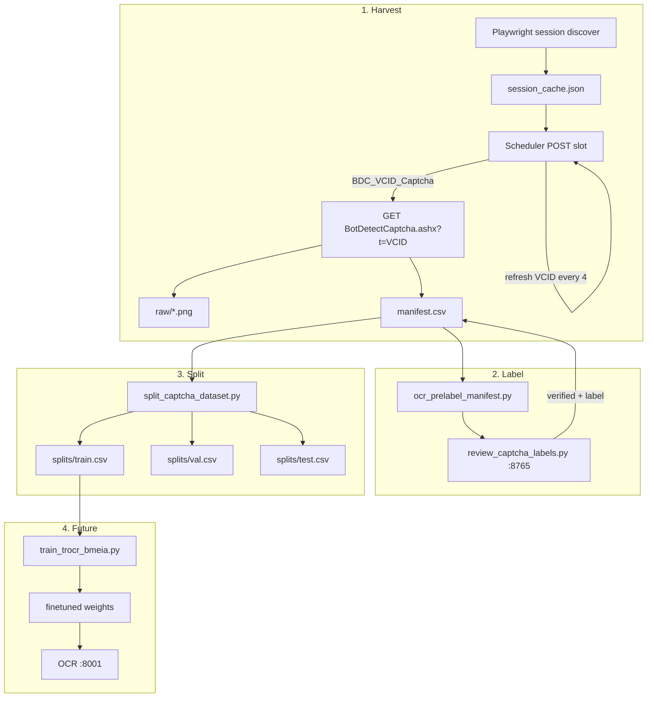

# BMEIA Captcha OCR Dataset Pipeline

**Purpose:** Collect, label, and split real BotDetect captcha images to finetune the production OCR model (`anuashok/ocr-captcha-v3` / TrOCR on VPS `:8001`).

**Last updated:** 2026-06-16

**Related docs:** [CAPTCHA_INVESTIGATION.md](CAPTCHA_INVESTIGATION.md) (production solver), [AGENT_HANDOFF.md](AGENT_HANDOFF.md) (VPS state)

---

## Executive summary

| Stage | Script | Output |
|-------|--------|--------|
| Harvest | `scripts/harvest_captcha_images.py` | PNGs + `manifest.csv` |
| OCR pre-label | `scripts/ocr_prelabel_manifest.py` | `ocr_guess` column |
| Human review | `scripts/review_captcha_labels.py` | `label`, `verified=true` |
| Split | `scripts/split_captcha_dataset.py` | `splits/train\|val\|test.csv` |
| Benchmark | `scripts/benchmark_captcha_harvest.py` | throughput JSON |

**Recommended harvest method:** `--method http` (~0.6–1 img/s). Playwright DOM capture is correct for **booking** but too slow (~3–5 s/image) for 5k collection.

**Not yet implemented:** `scripts/train/train_trocr_bmeia.py` (TrOCR finetune script).

---

## Why this exists (separate from production booking)

Production turbo booking uses **DOM screenshots** of the captcha element (`booker_legacy.capture_captcha_bytes_from_dom`) so the OCR input matches what the user sees in the browser.

For **training data collection**, HTTP-fetched BotDetect images are acceptable:

- Same BotDetect engine and style families
- Different render path (direct `BotDetectCaptcha.ashx` JPEG vs DOM screenshot)
- Much faster for bulk harvest (~5000 images target)

Do **not** commit dataset files — `datasets/` is gitignored.

---

## Architecture



---

## Directory layout

Default root: `datasets/bmeia-captcha-v1/` (gitignored)

```
datasets/bmeia-captcha-v1/
├── raw/                      # PNG files (saved as .png; source may be JPEG bytes)
│   └── 000001_a1b2c3d4_e5f6a7b8.png
├── manifest.csv              # Master index (all stages read/write this)
├── session_cache.json        # Cached sessionCookie + slot fields (HTTP harvest)
├── harvest_report.json       # Last harvest run summary
├── prelabel_report.json      # Last OCR pre-label summary
├── split_report.json         # Last split summary
├── benchmark_harvest.json    # Optional benchmark output
└── splits/
    ├── train.csv
    ├── val.csv
    └── test.csv
```

**Filename pattern:** `{id:06d}_{vcid_tail8}_{sha256_prefix8}.png`

---

## Manifest schema

`manifest.csv` columns (defined in `scripts/captcha_dataset_lib.py`):

| Column | Set by | Description |
|--------|--------|-------------|
| `id` | harvest | Monotonic integer row id |
| `filename` | harvest | Basename under `raw/` |
| `path` | harvest | Relative path, e.g. `raw/000001_….png` |
| `sha256` | harvest | Content hash — dedupe key |
| `vcid` | harvest | Full `BDC_VCID_Captcha` / BotDetect `t=` param |
| `vcid_tail` | harvest | Last 8 chars of VCID (human-readable) |
| `difficulty` | harvest | `easy` / `medium` / `hard` via `booker_legacy._assess_captcha_difficulty` |
| `ocr_guess` | pre-label | OCR service output (not ground truth) |
| `label` | review | Human-verified ground truth (4–8 uppercase alnum) |
| `verified` | review | `true` when label confirmed |
| `ocr_was_wrong` | review | `true` if label ≠ ocr_guess |
| `split` | split | `train` / `val` / `test` |
| `created_at` | harvest | UTC ISO timestamp |

**Resume-safe:** Harvest skips images whose SHA256 already exists in the manifest.

---

## HTTP harvest (recommended)

### BotDetect URL

```
GET https://appointment.bmeia.gv.at/BotDetectCaptcha.ashx?get=image&c=Captcha&t={vcid}
```

- `t=` is the **VCID** from hidden field `BDC_VCID_Captcha` in the scheduler capture-form HTML.
- Each GET with the **same** VCID still returns a **new unique image**.
- BMEIA rate-limits to roughly **5 GETs per VCID** before HTTP **429** (with ~350 ms delay between requests).

### VCID rotation

To obtain a new `t=` value, **re-POST the scheduler slot** (same as opening the capture form):

```
POST https://appointment.bmeia.gv.at/HomeWeb/Scheduler
  Language, Office, CalendarId, PersonCount, Monday, Start, Command=Next
```

Each POST returns fresh HTML containing a new `BDC_VCID_Captcha`. Implemented as `refresh_vcid_http()` in `scripts/captcha_harvest_http.py`.

### Session flow

1. **Playwright once** — `discover_session_playwright()` navigates KOPENHAGEN scheduler, captures `sessionCookie`, `currentMonday`, `currentSlot`. Saved to `session_cache.json`.
2. **Open form** — `open_capture_form_http()` POSTs slot → first VCID.
3. **Loop** — `fetch_captcha_http()` GET image → save to manifest.
4. **Every 4 images** (default) — `refresh_vcid_http()` for new VCID (stays under 5-GET limit).
5. **On 429** — sleep 2 s, refresh VCID, continue.
6. **Every 400 fetches** (default) — full Playwright rediscovery if cookie expires.

### CLI

```powershell
cd python-booker-webhook

# Bulk harvest (~5000 images, ~2–3 hours at ~0.6 img/s)
python scripts/harvest_captcha_images.py --count 5000 --method http --delay-ms 350 --vcid-refresh-every 4

# Resume: reuses session_cache.json, appends new rows, skips SHA256 dupes
python scripts/harvest_captcha_images.py --count 1000 --method http
```

| Flag | Default | Meaning |
|------|---------|---------|
| `--method` | `http` | `http` (fast) or `playwright` (DOM screenshot + reload) |
| `--count` | `100` | Target **new** images (dupes don't count) |
| `--delay-ms` | `350` | Pause between successful fetches |
| `--vcid-refresh-every` | `4` | Scheduler re-POST for new `t=` after N images |
| `--session-refresh-every` | `400` | Full Playwright rediscovery after N total fetches |
| `--session-cache` | `<dataset>/session_cache.json` | Reuse session across runs |
| `--office` | `KOPENHAGEN` | Dev stand-in (see TESTING_KOPENHAGEN.md) |
| `--calendar-id` | `9677702` | KOPENHAGEN calendar id |
| `--dataset-dir` | `datasets/bmeia-captcha-v1` | Override dataset root |

### Playwright harvest (slow, reference)

```powershell
python scripts/harvest_captcha_images.py --count 50 --method playwright --delay-ms 900
```

Navigates to capture form, DOM-screenshots captcha, clicks BotDetect reload link, repeats. ~3–5 s per image. Use only for DOM-vs-HTTP comparison, not bulk collection.

---

## Module reference

### `scripts/captcha_dataset_lib.py`

Shared library — manifest I/O, SHA256 dedupe, difficulty assessment, stratified splits.

Key functions:

| Function | Purpose |
|----------|---------|
| `load_manifest` / `save_manifest` | CSV read/write with fixed schema |
| `known_sha256` | Set of existing hashes for dedupe |
| `assess_difficulty` | Delegates to `booker_legacy._assess_captcha_difficulty` |
| `split_verified_rows` | 80/10/10 stratified by difficulty bucket |
| `write_split_csvs` | Writes `splits/train.csv`, etc. |
| `validate_label` | `^[A-Z0-9]{4,8}$` after normalization |

### `scripts/captcha_harvest_http.py`

HTTP transport layer — no manifest I/O.

| Function | Purpose |
|----------|---------|
| `captcha_image_url(origin, vcid)` | Builds BotDetect GET URL |
| `post_select_slot_http(...)` | Scheduler POST → `(html, updated_cookie)` |
| `fetch_captcha_http(...)` | GET captcha bytes; raises on 429 |
| `discover_session_playwright(...)` | One-time Playwright → payload dict |
| `refresh_vcid_http(...)` | Re-POST slot → new VCID |
| `open_capture_form_http(payload)` | Alias for first `refresh_vcid_http` |
| `save_session_cache` / `load_session_cache` | JSON session persistence |
| `harvest_captcha_batch_http(...)` | Core loop with VCID rotation + callbacks |
| `benchmark_method_http_burst(...)` | Throughput measurement (single VCID) |

### `scripts/harvest_captcha_images.py`

CLI entry — wires HTTP or Playwright harvest to manifest saves via `_save_captcha_row()`.

### `scripts/ocr_prelabel_manifest.py`

Batch-calls OCR `/predict` for each manifest row without `ocr_guess`.

```powershell
set CAPTCHA_OCR_BASE_URL=http://127.0.0.1:8001
python scripts/ocr_prelabel_manifest.py
python scripts/ocr_prelabel_manifest.py --force   # re-run all
python scripts/ocr_prelabel_manifest.py --enhance # apply enhance_botdetect_image
```

Requires `CAPTCHA_OCR_BASE_URL`. Does **not** set `verified=true`.

### `scripts/review_captcha_labels.py`

Local web UI at `http://127.0.0.1:8765` for human QC.

```powershell
python scripts/review_captcha_labels.py
python scripts/review_captcha_labels.py --difficulty hard
python scripts/review_captcha_labels.py --all --port 8765
```

- Prefills editable text box from `ocr_guess`
- **OCR correct** — saves label = ocr_guess, sets `verified=true`
- **Save label** — saves edited text, sets `ocr_was_wrong` if changed
- Prev/Next browse without saving; each save writes `manifest.csv` immediately

### `scripts/split_captcha_dataset.py`

Stratified train/val/test from verified rows only.

```powershell
python scripts/split_captcha_dataset.py
python scripts/split_captcha_dataset.py --train 0.8 --val 0.1 --seed 42
```

Fails if no `verified=true` rows.

### `scripts/benchmark_captcha_harvest.py`

Compares HTTP burst vs Playwright DOM+reload throughput.

```powershell
python scripts/benchmark_captcha_harvest.py --samples 25 --delay-ms 350
python scripts/benchmark_captcha_harvest.py --samples 20 --http-only
```

Output: `datasets/bmeia-captcha-v1/benchmark_harvest.json`

---

## End-to-end workflow (5k target)

```powershell
cd python-booker-webhook

# 1. Harvest
python scripts/harvest_captcha_images.py --count 5000 --method http --delay-ms 350

# 2. OCR pre-label (local or VPS OCR)
set CAPTCHA_OCR_BASE_URL=http://127.0.0.1:8001
python scripts/ocr_prelabel_manifest.py

# 3. Human review
python scripts/review_captcha_labels.py --difficulty hard

# 4. Split verified rows
python scripts/split_captcha_dataset.py

# 5. (Future) Finetune TrOCR
# python scripts/train/train_trocr_bmeia.py --splits datasets/bmeia-captcha-v1/splits
```

---

## Tests

```powershell
pytest tests/unit/test_captcha_dataset_lib.py -q
pytest tests/unit/test_captcha_harvest_http.py -q
pytest tests/integration/test_captcha_dataset_pipeline.py -q
```

Coverage:

- Manifest round-trip, label validation, split math
- `captcha_image_url`, session cache, mocked VCID refresh
- Review UI HTTP handler smoke test with tiny PNG fixture

---

## Troubleshooting

| Symptom | Cause | Fix |
|---------|-------|-----|
| `Captcha GET rate limited (429)` | >5 GETs per VCID or too fast | Default `--vcid-refresh-every 4` + `--delay-ms 350`; harvest auto-refreshes on 429 |
| `Scheduler POST rate limited (429)` | Too many slot POSTs | Increase delay; delete stale `session_cache.json` and rediscover |
| `No session cookies captured` | Playwright navigation failed | Check office/calendar; slots may be unavailable |
| `No manifest rows` | Harvest not run | Run `harvest_captcha_images.py` first |
| `CAPTCHA_OCR_BASE_URL is not set` | Missing env | Set in `.env` or shell |
| `no verified rows` | Review skipped | Run `review_captcha_labels.py` |
| Duplicate skips during harvest | Same image bytes seen before | Expected — SHA256 dedupe; loop continues until `--count` new images |
| Stale session after hours | Cookie expired | Delete `session_cache.json` or wait for `--session-refresh-every` |

---

## Design decisions

| Decision | Rationale |
|----------|-----------|
| HTTP harvest for training, DOM for booking | Speed vs pixel-accuracy tradeoff; training needs volume |
| VCID rotate every 4, not 5 | Safety margin under BMEIA ~5 GET/VCID limit |
| 350 ms default delay | Empirical: 0 ms → 429 after ~5 requests |
| Manifest is single source of truth | Resume-safe, review UI writes in place |
| KOPENHAGEN defaults | Dev stand-in; production Cairo uses same BotDetect engine |
| Labels human-only | OCR pre-label is assistive; `verified=true` required for splits |

---

## Open work

**Current focus (2026-06-16):** Harvest + label ~5k captcha images for OCR finetune. VPS deploy and `CAPTCHA_SOLVER` re-evaluation happen **after** finetune (see [V1_0_1_PROBLEMS_AND_MERGE_PLAN.md](./V1_0_1_PROBLEMS_AND_MERGE_PLAN.md) — S7 deferred).

- [ ] `scripts/train/train_trocr_bmeia.py` — finetune from `splits/*.csv`
- [ ] Deploy finetuned weights to VPS OCR `:8001`
- [ ] Re-evaluate production `CAPTCHA_SOLVER` after finetune (see CAPTCHA_INVESTIGATION.md)
- [x] Merge v1.0.1 OCR pipeline fixes to production root (2026-06-16) — see [V1_0_1_PROBLEMS_AND_MERGE_PLAN.md](./V1_0_1_PROBLEMS_AND_MERGE_PLAN.md)
