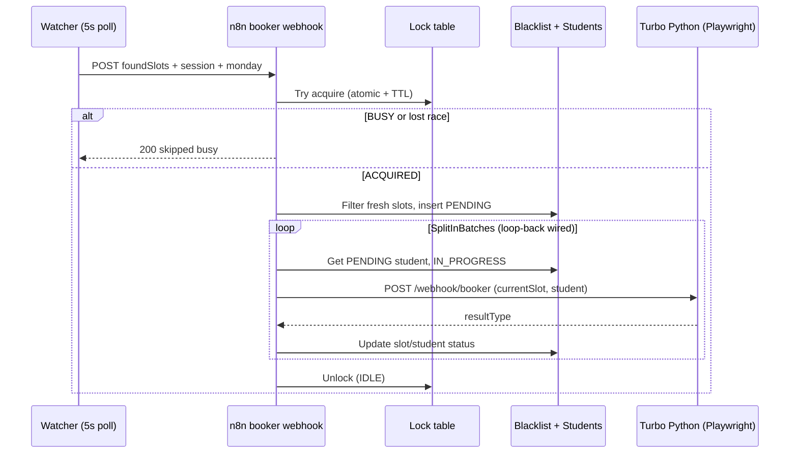

# n8n Booker Lock + Integration — Documentation Plan & Checklist

**Created:** 2026-06-14  
**Status:** Sandbox v1 built (`versions/lock-integration-v1/`) — live booker **unchanged**  
**Purpose:** Single living doc to iterate lock implementation, watcher↔booker↔turbo integration, tests, and findings. Update this file after each session.

**Related docs:** [AGENT_HANDOFF.md](AGENT_HANDOFF.md) · [n8n-booking-result-flow.md](n8n-booking-result-flow.md) · [PARALLEL_BOOKING.md](PARALLEL_BOOKING.md) · [n8n-scheduler-workflow.md](n8n-scheduler-workflow.md)

**Workflow exports (reference):** repo root `current booker.json`, `current Austria Kairo Appointment Watcher v3.json`

---

## Security — credentials

**Never commit API keys or ngrok authtokens to this repo.**

| Secret | Store in | Used for |
|--------|----------|----------|
| n8n Enterprise API JWT | `.env.n8n.local` (gitignored) | Fetch/update workflows, executions |
| ngrok authtoken | `.env.n8n.local` or `ngrok config` | Tunnel local `:8000` → booker HTTP node URL |
| `GEMINI_API_KEY`, etc. | `.env` (existing) | Python booker |

Template: [`.env.n8n.local.example`](../.env.n8n.local.example)

If keys were pasted in chat, rotate/regenerate after implementation.

---

## Documentation plan (phases)

Use this order. Check off phases as completed; append findings to [§ Findings log](#findings-log) after each phase.

### Phase 0 — Baseline (done in dev session)

- [x] Code review: turbo-only path, `booker_legacy.py`, concurrency
- [x] Local pytest suite (46 tests)
- [x] Live turbo test: scan → book SUCCESS (~7.6s, OCR)
- [x] Parallel 4-applicant stress test: 1 SUCCESS, 3× HTTP 500 (Playwright greenlet)
- [x] Deep research: watcher ↔ booker ↔ Python, ASP.NET session, lock pattern
- [x] Export current n8n workflow IDs via API (after credentials in `.env.n8n.local`)
- [x] Document live n8n base URL and workflow IDs in [§ Environment registry](#environment-registry)

### Phase 1 — Documentation & design (this file)

- [x] Create implementation plan + master checklist
- [ ] Review with user: lock flow, student-per-slot vs one-student-all-slots
- [ ] Finalize lock table schema in n8n Data Table
- [ ] Sequence diagram for locked booker execution (update below if design changes)

### Phase 2 — Local dev tunnel (ngrok)

- [x] Add ngrok authtoken locally (not in git) — `versions/lock-integration-v1/.env.n8n.local`
- [x] Run `uvicorn app:app --host 127.0.0.1 --port 8010 --workers 1` (sandbox copy, not port 8000)
- [x] Start ngrok → HTTPS URL for `POST /webhook/booker` (sandbox Python)
- [x] Smoke: health via tunnel (`GET /health` through ngrok OK)
- [x] Record tunnel URL + date in [§ Environment registry](#environment-registry)

### Phase 3 — n8n API sync

- [x] Authenticate to n8n API; list workflows; map IDs for **booker** and **Watcher v3**
- [x] Pull live JSON; diff vs `current booker.json` / watcher export (copied to sandbox)
- [x] Update booker **HTTP Request** node URL → ngrok (sandbox workflow only)
- [ ] Set booker workflow **max concurrent executions = 1**
- [ ] Set watcher workflow **max concurrent executions = 1** (avoid overlapping scans)

### Phase 4 — Booker lock implementation

- [ ] Create Data Table `booker_lock` (or single-row table) — see [§ Lock table schema](#lock-table-schema)
- [x] **Sandbox v1:** workflow static data lock (10 min TTL) instead of Data Table
- [x] Nodes: **Try Acquire Lock** → IF busy → **Respond 200 skipped** → END
- [x] Nodes: IF acquired → existing blacklist/slot flow
- [x] Wire **Unlock** on SplitInBatches done path
- [x] Wire **SplitInBatches loop-back** from result branches + HTTP error output
- [ ] Error workflow or janitor: clear stale lock when `expires_at < now` (TTL steal in acquire code only)
- [x] Push **new** workflow via n8n API (`booker-lock-sandbox-v1`, **active** for testing)
- [x] Activate sandbox workflow + manual webhook tests (T2 busy skip verified)

### Phase 5 — Watcher alignment (turbo-only, session deferred)

- [x] Sandbox watcher: **KOPENHAGEN** / `9677702` → `booker-lock-sandbox` (`watcher-kopenhagen-sandbox-v1`)
- [x] Rename node `Every 60 Seconds` → `Every 5 Seconds` (sandbox copy)
- [x] Booker HTTP timeout **300s** on watcher → sandbox booker (was 10s)
- [x] Full E2E: watcher scan → booker-lock → Python turbo (`run_full_watcher_booker_test.py`)
- [ ] Workflow setting: max concurrent executions = 1 (live + sandbox)
- [ ] _Deferred:_ Remove `POST Select Slot` → `Extract Booking Form Data` chain
- [x] Busy booker returns 200 `{ skipped: true, reason: "BOOKER_BUSY" }` (T2 verified)
- [ ] Optional: watcher reads lock table and skips webhook when BUSY (noise reduction)

### Phase 6 — Test matrix execution

Run tests in [§ Test checklist](#test-checklist); log results in [§ Findings log](#findings-log).

### Phase 7 — Production hardening (later)

- [ ] Replace ngrok with stable VPS URL
- [ ] KAIRO end-to-end (not KOPENHAGEN pin data)
- [ ] `maxCaptchaRetries: 5`, VPS `gemini_first`
- [ ] n8n retry HTTP **503 only** (not 500/CAPTCHA_FAIL)
- [ ] Session: fresh cookie per slot (section 3 enhancement — deferred)

---

## Target architecture (agreed direction)

**User-confirmed booker flow (orchestration):**

1. Webhook  
2. Get lock → if **busy** → break (200 skip)  
3. If **not busy** → set **locked** (with TTL)  
4. Get student + **loop slots** (current SplitInBatches pattern)  
5. After all slots processed / no work → **unlock**  
6. Watcher may fire again only after unlock; overlapping webhooks skip safely  

**Second layer:** VPS `BOOKING_USE_GLOBAL_LOCK=true` + `--workers 1` (Playwright backstop).

---

## Lock table schema

Suggested n8n Data Table row (keyed by office or global):

| Column | Type | Example | Notes |
|--------|------|---------|-------|
| `lock_key` | string | `booker_KAIRO` | Primary key |
| `status` | string | `IDLE` / `BUSY` | |
| `locked_at` | datetime | ISO8601 | |
| `expires_at` | datetime | locked_at + 10–15 min | Stale steal |
| `locked_by_execution_id` | string | n8n `$execution.id` | Only holder may unlock |
| `last_result` | string | `SKIPPED_BUSY`, `COMPLETED` | Ops |
| `payload_fingerprint` | string | optional hash | Dedup logging |

**Acquire (must be atomic):** update to BUSY only where `status=IDLE OR expires_at < now`; if 0 rows updated → skip.

**Release:** set IDLE where `locked_by_execution_id = current execution` OR expired.

---

## Known gaps (from research & live tests)

| ID | Issue | Severity | Status |
|----|--------|----------|--------|
| G1 | SplitInBatches no loop-back → likely only first slot per exec | Critical | **Fixed in sandbox** (`booker-lock-v1.json`) |
| G2 | No global n8n lock → watcher 5s stacks executions | Critical | **Fixed in sandbox** (static data lock v1) |
| G3 | Shared `sessionCookie` across slots in one exec | High | **Deferred** (user: leave session as-is for now) |
| G4 | Watcher `POST Select Slot` on `firstSlot` redundant for turbo | Medium | Deferred |
| G5 | Watcher BDC extract not passed to Python | Info | By design; turbo refreshes in Playwright |
| G6 | Parallel booker → Playwright greenlet 500 | Critical | Mitigated by lock + VPS flock |
| G7 | Booker HTTP → ngrok URL in export | Ops | Update in Phase 3 |
| G8 | `maxCaptchaRetries: 10` in n8n body | Medium | Tune later |

---

## Test checklist

Mark `[ ]` → `[x]` and add row to [§ Findings log](#findings-log).

### Automated (local)

| ID | Test | Command / artifact | Pass? |
|----|------|-------------------|-------|
| A1 | Unit/smoke pytest | `python -m pytest . --ignore=scripts --ignore=docs` | [x] 46 passed (2026-06-14) |
| A2 | Compile | `python -m py_compile app.py booker_legacy.py` | [x] |
| A3 | OCR API | `python test_ocr_captcha_api.py` | [x] |

### Integration (manual / scripted)

| ID | Test | Expected | Pass? |
|----|------|----------|-------|
| T1 | Lock acquire happy path | BUSY → book → IDLE | [ ] |
| T2 | Second webhook while locked | 200 skipped, no 2nd Python call | [x] 4/4 BOOKER_BUSY when lock held (2026-06-14) |
| T3 | Stale lock steal | Expired BUSY → new exec acquires | [ ] |
| T4 | Kill exec mid-booking | After TTL, next webhook OK | [ ] |
| T5 | Multi-slot serial (2+ slots) | All slots in **one** execution | [ ] |
| T6 | SplitInBatches loop-back | N iterations in one `$execution.id` | [ ] |
| T7 | No fresh slots | Unlock, no VPS call | [ ] |
| T8 | No PENDING students | Unlock, Telegram | [ ] |
| T9 | Python HTTP error | Reset PENDING + unlock | [ ] |
| T10 | Watcher hammer 30s | ≤1 active booking | [ ] |
| T11 | Turbo SUCCESS KOPENHAGEN | scan → payload → `run_turbo_payload.py` | [x] ~7.6s |
| T13 | Watcher → booker-lock sandbox E2E | Watcher finds slots, booker calls Python | [x] 2026-06-14 (exec 1653266→1653268) |
| T14 | Dummy applicant + live scan | `run_kopenhagen_e2e_test.py` / `run_full_watcher_booker_test.py` | [x] |
| T12 | Parallel 4 POSTs | 1 SUCCESS, 3× 500 (pre-lock baseline) | [x] documented |

### Logging requirements (each integration test)

- [ ] n8n execution log: lock acquire/release, `$execution.id`, per-slot `resultType`
- [ ] VPS `debug-ce612b.log`: `global_flock_*`, `sessionIdTail`, `playwright_launch`
- [ ] Artifacts: `artifacts/<runId>-turbo/attempt_*`
- [ ] Network: scheduler POST `Cookie`, `Start`, `Monday`; `Set-Cookie` on first POST
- [ ] Optional HAR for one success + one busy-skip

---

## Environment registry

Fill during Phase 2–3. **No secrets in this table.**

| Item | Value | Updated |
|------|-------|---------|
| n8n base URL | `https://n8n.acmeai.crabdance.com` | 2026-06-14 |
| **Live** booker workflow ID | `V2giHI6bqFpWq8ff` | 2026-06-14 |
| **Sandbox** booker-lock workflow ID | `CLTCcjVtgfjqyMnF` (**active** for testing) | 2026-06-14 |
| **Sandbox** watcher (KOPENHAGEN) | `8o4tnLxWbWKRgfTq` (**active** for testing) | 2026-06-14 |
| Watcher workflow ID | `KTw5aLQjJhT7fpxN` (live KAIRO — unchanged) | 2026-06-14 |
| Live booker webhook path | `/webhook/booker` | |
| Sandbox webhook path | `/webhook/booker-lock-sandbox` | 2026-06-14 |
| Python booker URL (live export) | ngrok in `current booker.json` | |
| Python booker URL (sandbox tunnel) | `https://bluish-finalist-carnage.ngrok-free.dev/webhook/booker` | 2026-06-14 |
| Local sandbox uvicorn | `http://127.0.0.1:8010` | 2026-06-14 |
| Sandbox folder | `versions/lock-integration-v1/` | 2026-06-14 |
| VPS production URL | _optional later_ | |

---

## n8n API operations checklist (Phase 3+)

Use JWT from `.env.n8n.local`. Typical Enterprise public API paths (verify against your instance):

- [x] `GET /api/v1/workflows` — list IDs
- [x] `GET /api/v1/workflows/:id` — pull live JSON
- [x] `PUT /api/v1/workflows/:id` — push updates (sandbox only)
- [ ] `GET /api/v1/executions` — inspect lock/skip behavior
- [ ] `POST /api/v1/workflows/:id/activate` — activate sandbox when ready

Document actual base path and any Enterprise prefix in [§ Findings log](#findings-log) after first successful call: **`/api/v1/workflows`** works with `X-N8N-API-KEY`. Create rejects `settings.binaryMode`.

---

## Booker workflow change checklist (Phase 4)

### New nodes

- [ ] `Get Lock Row` (Data Table get)
- [ ] `Try Acquire Lock` (Code: atomic compare-and-set or conditional update)
- [ ] `IF Lock Busy` → `Respond Skipped` (Respond to Webhook or Set + stop)
- [ ] `Set Lock BUSY` (with `expires_at`, `locked_by_execution_id`)
- [ ] `Unlock Lock` (Merge inputs from all exits)
- [ ] Optional: `Error Trigger` workflow → force unlock if holder matches

### Wiring fixes (existing)

- [ ] `One Slot at a Time` ← loop-back from: SUCCESS, CAPTCHA_FAIL, SLOT_TAKEN, ALREADY_BOOKED, HTTP error → reset branches
- [ ] `Telegram: All Done` ← SplitInBatches output 0 only
- [ ] All terminal branches → `Unlock` → (optional) respond

### HTTP Request node (Python)

- [ ] URL = active ngrok or VPS
- [ ] `retryOnFail`: retry **503 only** (configure when n8n supports expression)
- [ ] `maxCaptchaRetries`: consider 5 (later)
- [ ] `runId`: `{{ $execution.id }}` (keep)

---

## Watcher workflow change checklist (Phase 5 — optional)

- [x] Sandbox copy: `patch_watcher_kopenhagen.py` → `watcher-kopenhagen-sandbox-v1.json`
- [x] Config → KOPENHAGEN / 9677702; webhook → `/webhook/booker-lock-sandbox`
- [x] Rename node `Every 60 Seconds` → `Every 5 Seconds` (+ fix connections key)
- [ ] Workflow setting: max concurrent executions = 1
- [ ] _Deferred:_ Remove `POST Select Slot` → `Extract Booking Form Data` chain
- [ ] _Deferred:_ Optional lock read before `Send to Booker Webhook`

---

## Findings log

Append-only. Newest first.

### 2026-06-14 — KOPENHAGEN watcher + full E2E

| Finding | Source | Action |
|---------|--------|--------|
| Sandbox watcher `8o4tnLxWbWKRgfTq` scans KOPENHAGEN live dates | BMEIA POST | Init Monday → server week `6/15/2026` |
| `Filter_slots` hardcoded KAIRO blocked KOPENHAGEN retry path | booker exec 1653206 | Fixed: filter by webhook `Office` in `patch_booker_lock.py` |
| Watcher 10s timeout too short for turbo booking | deep-web-debugger | Sandbox watcher timeout → 300s |
| Overlapping 5s watcher ticks cause BOOKER_BUSY | full test | `run_full_watcher_booker_test.py` arms one tick then deactivates |
| Full path validated | exec 1653266→1653268 | Watcher → booker → HTTP Request → Python (slot reset/PENDING) |
| Loop every 5m | user `/loop` | `run_full_watcher_booker_test.py` on tick |

### 2026-06-14 — Sandbox lock-integration-v1

| Finding | Source | Action |
|---------|--------|--------|
| Isolated sandbox at `versions/lock-integration-v1/` | User request | All edits in copy; live `booker` + root Python untouched |
| n8n create API rejects `settings.binaryMode` | API 400 | Strip on push; keep `executionOrder` only |
| Lock v1 uses workflow static data (10 min TTL) | `patch_booker_lock.py` | Data Table lock deferred |
| Loop-back wired to `One Slot at a Time` | `booker-lock-v1.json` | Addresses G1 |
| Duplicate sandbox workflow `gfteX0Pcc8S6LjPT` | First push before id tracking | **Archived**; canonical `CLTCcjVtgfjqyMnF` |
| Webhook `responseMode` must be top-level `responseNode`, not inside `options` | n8n API 500 | Fixed in `patch_booker_lock.py` |
| Stale lock blocks all webhooks until TTL/clear | T2 all busy | `run_lock_integration_tests.py` clears staticData before hammer |
| ngrok tunnel | `bluish-finalist-carnage.ngrok-free.dev` → `:8010` | Re-run patch+push if URL changes |

### 2026-06-14 — Planning session

| Finding | Source | Action |
|---------|--------|--------|
| Turbo-only; legacy unused | User + code review | Scope lock work to `/webhook/booker` turbo path |
| User lock flow matches single-flight design | Discussion | Implement Phase 4 per [Target architecture](#target-architecture-agreed-direction) |
| Session strategy deferred | User | G3 open; no watcher session changes yet |
| ngrok URL OK for now | User | Phase 2–3; production URL later |
| Parallel 4 test: 1/4 SUCCESS, greenlet 500 | `parallel-4-results.json` | Validates need for lock before multi-exec |
| Full serial test: SUCCESS ~7.6s OCR | `full-test-live-001` | Baseline turbo healthy on KOPENHAGEN |
| Watcher BDC not sent to Python | `current booker.json` HTTP body | Turbo refreshes captcha via Playwright; watcher extract is dead weight |
| Watcher `firstSlot` select not used by turbo | Code: `currentSlot` from booker | Side effect on session only |
| ASP.NET: fresh SessionId on first POST with `AspxAutoDetectCookieSupport=1` | Docs + MS session model | Supports future per-slot fresh session |
| Credentials provided for n8n API + ngrok | User chat | Store in `.env.n8n.local`; rotate after use |

---

## Iteration notes (for next agent session)

1. Read this file + [AGENT_HANDOFF.md](AGENT_HANDOFF.md)  
2. Complete unchecked items top-to-bottom in [Documentation plan](#documentation-plan-phases)  
3. After each test or API change: update checklist + add [Findings log](#findings-log) row  
4. Do **not** commit `.env.n8n.local`  
5. When lock is live: re-run T2, T5, T10 before KAIRO production  

---

## Doc map (keep in sync)

| When you change… | Also update… |
|------------------|--------------|
| Lock schema or flow | This file § Target architecture, § Booker workflow checklist |
| n8n result routing | [n8n-booking-result-flow.md](n8n-booking-result-flow.md) |
| Concurrency / VPS | [PARALLEL_BOOKING.md](PARALLEL_BOOKING.md), [AGENT_HANDOFF.md](AGENT_HANDOFF.md) |
| Watcher scan contract | [n8n-scheduler-workflow.md](n8n-scheduler-workflow.md) |
| When sandbox watcher/booker changes | `versions/lock-integration-v1/README.md`, `docs/n8n-workflow-ids.json`, this file § Environment registry |
