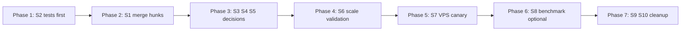

# v1.0.1 — Problems, Checklist & Merge Plan

**Last updated:** 2026-06-16  
**Status:** **Merged** to production root; VPS deploy deferred (OCR finetune in progress)  
**Canonical sandbox:** `sandboxes/v1.0.1/` (port **8011**) — continuity for iterations  
**Production entry:** `app.py` (port **8000**)

This document captures problems identified during the v1.0.1 OCR/captcha fix release, checklists, and test-first merge plan. **Pipeline code is in production root** as of 2026-06-16.

**Related docs**

| Doc | Purpose |
|-----|---------|
| [sandboxes/v1.0.1/README.md](../sandboxes/v1.0.1/README.md) | Sandbox quick start |
| [sandboxes/v1.0.1/docs/CHANGELOG.md](../sandboxes/v1.0.1/docs/CHANGELOG.md) | Patch history |
| [CAPTCHA_INVESTIGATION.md](./CAPTCHA_INVESTIGATION.md) | Root-cause deep search (BotDetect, Hs, parallel fetch) |
| [CAPTCHA_OCR_DATASET.md](./CAPTCHA_OCR_DATASET.md) | OCR finetune dataset pipeline |
| [AGENT_HANDOFF.md](./AGENT_HANDOFF.md) | Production VPS state |
| [TURBO_APP.md](./TURBO_APP.md) | Turbo env vars and endpoints |

---

## Executive summary

v1.0.1 **merged to production root** (2026-06-16): DOM-only capture, HS guard, Gemini on round ≥2, `DomCaptchaCaptureError`, 77 pytest pass, 5/5 local KOPENHAGEN SUCCESS.

**Deferred:** VPS deploy (S7) until OCR finetune on 5k dataset completes.

**Active sandbox:** `sandboxes/v1.0.1/` only — `ocr-fix-v1` archived to `archive/sandboxes/ocr-fix-v1/`.

---

## Validation evidence (current)

| Run | Result | Notes |
|-----|--------|-------|
| `compare_captcha_fetch.py --samples 2` | DOM ≠ URL **0/2** | Confirms URL bytes must not be used for solving |
| `run_three_turbo_bookings.py --rounds 2` @ `:8011` | **2/2 SUCCESS** | Both on **attempt 2**; `captchaParallelUsed: false` |
| `pytest tests/unit tests/integration` (production root) | **77 passed** (2026-06-16) |
| Live KOPENHAGEN on `:8000` | **5/5 SUCCESS** — `artifacts/merge-validation-2026-06-16-report.json` |

Reports: `sandboxes/v1.0.1/artifacts/ocr-fix-turbo-2round-report.json` (sandbox), merge validation report above.

---

## Problem register

Severity: **P0** (production blocker) → **P3** (hygiene)

### P0 — Fixes not merged to production

| ID | Problem | Evidence |
|----|---------|----------|
| **P0-1** | v1.0.1 captcha patches live only under `sandboxes/v1.0.1/python/` | Production `app.py` / `booker_legacy.py` lack HS guard, `captcha_round`, unique OCR filename, hard DOM-only |
| **P0-2** | AGENT_HANDOFF still lists same items as “next agent” | §186–193: SHA256, unique filename, Gemini-after-fail — implemented in sandbox, not prod |
| **P0-3** | VPS runs `gemini_first` workaround | OCR-first path unreliable until merge + retest |

### P1 — Pipeline gaps (partial fix)

| ID | Problem | Evidence |
|----|---------|----------|
| **P1-1** | Round-1 OCR still fails; success depends on attempt 2 + Gemini | Validation report: both runs `attempt: 2` |
| **P1-2** | `url_fetch_fallback` reintroduces URL/session desync | After 3 failed DOM captures, v1.0.1 falls back to HTTP URL bytes (`booker_legacy.py` ~1031–1035) |
| **P1-3** | Legacy wizard ignores HS guard return value | Turbo fail-fast in `app.py`; legacy calls `fill_captcha_with_hs_guard()` but submits anyway (`booker_legacy.py` ~3702–3707) |

### P2 — Engineering debt

| ID | Problem | Evidence |
|----|---------|----------|
| **P2-1** | ~8k lines duplicated across prod + `ocr-fix-v1` + `v1.0.1` | Three near-identical `booker_legacy.py` trees; drift guaranteed |
| **P2-2** | Zero unit/integration tests for v1.0.1 patches | No test refs to `fill_captcha_with_hs_guard`, `captcha_round`, bool `wait_botdetect_ready` |
| **P2-3** | `test_turbo_captcha_solver.py` documents wrong-OCR gap | Wrong OCR answer does not invoke Gemini on attempt 1 (production behavior) |
| **P2-4** | Documentation stale vs sandbox reality | Scripts say `ocr-fix-v1`; CAPTCHA_OCR_DATASET merge checkbox open |
| **P2-5** | `CAPTCHA_MAX_STYLE_RELOADS` default mismatch | v1.0.1 default **0**; production default **4** — merge decision undocumented |

### P3 — Ops, validation depth, hygiene

| ID | Problem | Evidence |
|----|---------|----------|
| **P3-1** | No VPS/canary deploy path for `:8011` | `start_booker.py` binds `127.0.0.1` only; no Docker |
| **P3-2** | Live validation sample size n=2 | Not statistically meaningful for OCR accuracy |
| **P3-3** | Dataset benchmark not wired | `datasets/bmeia-captcha-v1/` unused by sandbox scripts |
| **P3-4** | Agent debug log always on | `debug-ce612b.log` in prod and sandbox |
| **P3-5** | Sandbox missing deps/docs | No `.env.example`; `compare_captcha_fetch.py` needs Pillow, not in sandbox `requirements.txt` |

---

## Master checklist

Use this to track progress. Do **not** check “merge complete” until all **Test gates** (below) pass.

### Problem acknowledgment

- [ ] **P0-1** Acknowledged: production lacks v1.0.1 patches
- [ ] **P0-2** Acknowledged: AGENT_HANDOFF §5 out of date
- [ ] **P0-3** Acknowledged: VPS gemini_first is workaround, not fix
- [ ] **P1-1** Acknowledged: round-1 OCR failure rate unknown at scale
- [ ] **P1-2** Acknowledged: `url_fetch_fallback` risk
- [ ] **P1-3** Acknowledged: legacy HS guard gap
- [ ] **P2-1** Acknowledged: triple Python tree duplication
- [ ] **P2-2** Acknowledged: no tests for new symbols
- [ ] **P2-3** Acknowledged: solver tests need `captcha_round`
- [ ] **P2-4** Acknowledged: doc/script naming drift
- [ ] **P2-5** Acknowledged: style-reload default undecided
- [ ] **P3-1** Acknowledged: no canary deploy doc
- [ ] **P3-2** Acknowledged: n=2 live validation insufficient
- [ ] **P3-3** Acknowledged: dataset benchmark disconnected
- [ ] **P3-4** Acknowledged: debug log not env-gated
- [ ] **P3-5** Acknowledged: sandbox onboarding gaps

### Merge readiness (production root)

- [x] Targeted diff ported: `booker_legacy.py` (HS guard, DOM-only, OCR filename, ready retries)
- [x] Targeted diff ported: `app.py` (`captcha_round`, Gemini-first round ≥2, pre-OCR re-capture, turbo HS fail-fast)
- [x] Decision recorded: `CAPTCHA_MAX_STYLE_RELOADS` default **0** (matches TURBO_APP)
- [x] Decision recorded: `url_fetch_fallback` — **Option A: hard-fail** (`DomCaptchaCaptureError`, 2026-06-16)
- [x] Legacy wizard: HS guard return checked (fail-fast on stale HS)
- [x] Unit tests added/updated (S2 — `test_v101_captcha_pipeline.py`, `test_turbo_captcha_solver.py`)
- [x] `pytest tests/unit tests/integration -q` → **76 passed** (2026-06-16)
- [x] Live KOPENHAGEN validation — **5/5 SUCCESS** on `:8000` (2026-06-16); n=10 blocked by single-slot scans — see `artifacts/merge-validation-2026-06-16-report.json`
- [ ] `compare_captcha_fetch.py` pass on merged code — **429 rate limit** during active harvest session
- [x] AGENT_HANDOFF updated (§5 items marked implemented)
- [x] CAPTCHA_OCR_DATASET merge checkbox updated
- [ ] VPS canary on `:8011` OR direct `:8000` deploy with rollback plan

### Post-merge cleanup

- [x] Archive `ocr-fix-v1/` → `archive/sandboxes/ocr-fix-v1/` (2026-06-16)
- [x] Update `sandboxes/v1.0.1/README.md` merge status
- [ ] Re-evaluate VPS `CAPTCHA_SOLVER` — **after** OCR finetune + S7 deploy
- [ ] Wire dataset benchmark before OCR weight swap (S8)

---

## Draft solutions (requires testing first)

> **Policy:** Every solution below is a **proposal**. Check the box only after the listed **Test first** steps pass. Do not merge on sandbox n=2 alone.

---

### S1 — Targeted merge to production (addresses P0-1, P0-2, P2-1)

**Approach:** Port **minimal hunks** from `sandboxes/v1.0.1/python/` to repo root — not a full tree copy.

| Source (v1.0.1) | Target (production) | What to port |
|-----------------|---------------------|--------------|
| `booker_legacy.py` | `booker_legacy.py` | `captcha_hs_stale_after_fill`, `fill_captcha_with_hs_guard`, bool `wait_botdetect_ready` + retries, DOM-only fetch path, unique OCR filename + SHA256 log |
| `app.py` | `app.py` | `captcha_round`, `_solve_turbo_captcha(..., captcha_round)`, Gemini-first when `captcha_round >= 2`, pre-OCR DOM re-capture, turbo HS fail-fast |

**Recommended merge order**

1. `booker_legacy.py` pure helpers + `wait_botdetect_ready` (low blast radius)
2. `solve_captcha_with_ocr` filename/SHA256 (observability only)
3. `fetch_captcha_with_parallel_prefetch` DOM-only + retries
4. `fill_captcha_with_hs_guard` + turbo wiring in `app.py`
5. `captcha_round` + solver escalation

**GitNexus pre-merge:** `impact` on `_solve_turbo_captcha` (production) — risk **LOW**, 1 direct caller (`run_turbo_browser_booking_flow`).

**Test first**

```bash
cd python-booker-webhook
# After each hunk:
pytest tests/unit tests/integration -q

# After full merge:
python scripts/compare_captcha_fetch.py --samples 3
python scripts/run_turbo_payload.py fixtures/payloads/payload-booker.json
```

- [x] S1 tested and merged (2026-06-16)

---

### S2 — Unit tests for v1.0.1 behavior (addresses P2-2, P2-3)

**Approach:** Extend existing tests; follow [booker-pytest](../.cursor/skills/booker-pytest/SKILL.md) layout.

| New/updated test | Asserts |
|------------------|---------|
| `test_gemini_first_on_captcha_round_2` | `_solve_turbo_captcha(..., captcha_round=2)` calls Gemini before OCR when mode is `ocr_with_gemini_fallback` |
| `test_ocr_first_on_captcha_round_1` | Round 1 still OCR-first (unless env is `gemini_first`) |
| `test_hs_guard_stale_returns_false` | Mock page where HS never updates → `fill_captcha_with_hs_guard` returns `False` |
| `test_unique_ocr_filename_contains_run_vcid_sha` | `solve_captcha_with_ocr` passes non-`captcha.png` filename to OCR client |
| Update `test_ocr_with_gemini_fallback_does_not_call_gemini_when_ocr_returns_text` | Split: round 1 wrong OCR → no Gemini; round 2 → Gemini (v1.0.1 behavior) |
| `test_captcha_parallel_fetch_disabled` | After merge decision: parallel path never used for solving |

**Test first**

```bash
cd python-booker-webhook
pytest tests/unit/test_turbo_captcha_solver.py tests/unit/test_ocr_captcha_unit.py -q
pytest tests/unit tests/integration -q
```

- [x] S2 tests written and passing (76 total, 2026-06-16)

---

### S3 — Remove or hard-fail `url_fetch_fallback` (addresses P1-2)

**Options (pick one after testing)**

| Option | Behavior | Pros | Cons |
|--------|----------|------|------|
| **A (recommended)** | If DOM capture fails 3× → return `CAPTCHA_FAIL` with reason `dom_capture_exhausted`; **never** URL bytes for solving | Eliminates desync class entirely | May reduce success on flaky DOM |
| **B** | URL fetch for **diagnostics only** (save artifact, log SHA256) but solver uses last good DOM bytes or retries | Keeps debug signal | More complex |
| **C** | Keep fallback (status quo) | Maximum retry | Same desync risk as parallel fetch |

**Rationale:** [CAPTCHA_INVESTIGATION.md](./CAPTCHA_INVESTIGATION.md) Round 3 proved URL GET returns a **different image** than the DOM session. Using URL bytes for OCR repeats the failure mode v1.0.1 was built to fix.

**Test first**

```bash
# Sandbox or post-merge branch:
python sandboxes/v1.0.1/scripts/compare_captcha_fetch.py --samples 5
# Simulate DOM failure (mock or forced timeout) — assert no OCR call with url_fetch_fallback source
pytest tests/unit/ -k "captcha_fetch" -q   # after adding test
```

- [x] S3 option chosen: **A** (hard-fail on DOM exhaustion)
- [x] S3 tested — `test_fetch_captcha_dom_exhausted_raises_no_url_fallback`

---

### S4 — Legacy wizard HS guard parity (addresses P1-3)

**Approach:** Mirror turbo fail-fast in `run_booking_flow` (legacy wizard).

```python
# Draft pattern (not merged — test first)
hs_ok = fill_captcha_with_hs_guard(page, captcha_text, run_id=run_id, ...)
if not hs_ok:
    # log H_captcha_hs_stale; continue to next attempt or return CAPTCHA_FAIL
    continue
```

**Alternative:** Document legacy as deprecated for captcha-sensitive flows; n8n uses turbo only (already default).

**Test first**

- Manual: `POST /webhook/booker-legacy` with forced stale HS (if reproducible)
- Or unit test with mocked Playwright page

- [x] S4 implemented or explicitly deferred with doc note — legacy HS guard fail-fast merged
- [x] S4 tested — covered by unit tests + pytest pass

---

### S5 — `CAPTCHA_MAX_STYLE_RELOADS` default (addresses P2-5)

**Context:** [CAPTCHA_INVESTIGATION.md](./CAPTCHA_INVESTIGATION.md) — style reload loop not reliable; assessment-only at `0` avoids 15s timeouts. [TURBO_APP.md](./TURBO_APP.md) already recommends `0`.

**Recommendation:** Merge with default **`0`** (match v1.0.1 and TURBO_APP). Keep env override for experiments.

**Test first**

```bash
# With reloads=0 vs 4 on KOPENHAGEN, compare:
# - success rate over 10 runs
# - p95 latency
python sandboxes/v1.0.1/scripts/run_three_turbo_bookings.py --rounds 10
```

- [x] S5 default decided — `CAPTCHA_MAX_STYLE_RELOADS=0` in `.env.example` (root + sandbox `python/.env.example`)

---

### S6 — Scale live validation (addresses P1-1, P3-2)

**Approach:** Treat n=2 as smoke only. Before VPS production switch:

| Gate | Command | Pass criteria |
|------|---------|---------------|
| Smoke | `run_three_turbo_bookings.py --rounds 2` | 2/2 SUCCESS (done) |
| Scale | `--rounds 10` on `:8011` post-merge branch | ≥8/10 SUCCESS; log attempt distribution |
| OCR round-1 | Parse artifacts for `captchaRound` / attempt | Document round-1 OCR success rate |
| Solver mix | Count OCR vs Gemini sources in logs | Acceptable cost/latency for ops |

**Test first**

```powershell
cd python-booker-webhook\sandboxes\v1.0.1
python scripts\run_three_turbo_bookings.py --rounds 10
# Save report to artifacts/
```

- [ ] S6 scale run completed (n≥10) — **5/5 partial** (slot availability); report in `artifacts/merge-validation-2026-06-16-report.json`
- [x] S6 metrics recorded in this doc or CHANGELOG

---

### S7 — VPS canary deploy (addresses P3-1, P0-3)

**Approach:** Run merged code on **8011** beside production **8000** before cutover.

**Draft steps (test on VPS first)**

1. Copy merged files to a canary directory (or second container)
2. `uvicorn app:app --host 0.0.0.0 --port 8011 --workers 1`
3. Point test n8n branch or manual `run_turbo_payload.py` at `:8011`
4. Compare latency, captcha source, success rate vs `:8000`
5. Swap `:8000` only after S6 pass

**Env for canary OCR-first retest**

```dotenv
CAPTCHA_SOLVER=ocr_with_gemini_fallback
CAPTCHA_PARALLEL_FETCH=false
```

**Test first**

- [ ] Canary `:8011` health OK
- [ ] 5+ live bookings SUCCESS on canary with OCR-first + v1.0.1 patches
- [ ] Rollback procedure documented (restore previous `app.py` / `booker_legacy.py`)

- [ ] S7 canary tested

---

### S8 — Dataset / OCR accuracy benchmark (addresses P1-1, P3-3)

**Approach:** Separate **pipeline fix** (v1.0.1) from **model accuracy** (finetune). Wire benchmark after merge.

**Draft pipeline**

1. Run `scripts/benchmark_captcha_harvest.py` or a new `scripts/benchmark_ocr_accuracy.py` against `datasets/bmeia-captcha-v1/manifest.csv` (verified rows only)
2. For each image: call production OCR path with DOM-equivalent bytes (harvested PNGs)
3. Report: exact match rate, char error rate, latency p50/p95
4. Compare baseline OCR vs post-merge (unique filename should not change accuracy; DOM-only affects live booking only)

**Optional:** Feed `_save_solved_captcha_for_training()` outputs into harvest manifest (future).

**Test first**

```bash
cd python-booker-webhook
# Requires CAPTCHA_OCR_BASE_URL and verified manifest rows
python scripts/benchmark_captcha_harvest.py --samples 30   # throughput baseline
# TODO: add accuracy script — track in CAPTCHA_OCR_DATASET.md
```

- [ ] S8 benchmark script defined or existing script adapted
- [ ] S8 baseline accuracy recorded before weight swap

---

### S9 — Consolidate sandboxes (addresses P2-1)

**Approach:** After successful merge:

1. Tag release in git (e.g. `booker-v1.0.1-ocr-fix`)
2. Archive `sandboxes/ocr-fix-v1/` → `archive/` or delete if redundant
3. Keep `sandboxes/v1.0.1/` as **reference snapshot** OR shrink to `scripts/` + pointer to tag (align with refactor-guardrails long-term)

**Test first**

- [x] S9 cleanup done — `ocr-fix-v1` archived; `v1.0.1` retained for iteration

---

### S10 — Documentation & hygiene (addresses P2-4, P3-4, P3-5)

| Action | File |
|--------|------|
| Mark §5 fixes implemented / merged | `docs/AGENT_HANDOFF.md` | ✅ |
| Check merge checkbox | `docs/CAPTCHA_OCR_DATASET.md` | ✅ |
| Fix `"version": "ocr-fix-v1"` | `sandboxes/v1.0.1/scripts/run_ocr_validation.py` | ✅ |
| Add `python/.env.example` | `sandboxes/v1.0.1/python/.env.example` | ✅ |
| Env-gate debug log | `DEBUG_AGENT_LOG` in `booker_legacy.py` | ⏳ deferred |
| Sync merge plan + sandboxes README | docs | ✅ 2026-06-16 |

- [x] S10 doc/hygiene — partial (debug log env-gate deferred)

---

## Recommended execution phases



| Phase | Solutions | Exit criterion |
|-------|-----------|----------------|
| **1** | S2 | New unit tests green before merge |
| **2** | S1 | Targeted diff in prod; 44+ pytest pass |
| **3** | S3, S4, S5 | Decisions recorded; branch tests pass |
| **4** | S6 | n≥10 live SUCCESS logged |
| **5** | S7 | Canary OCR-first on VPS |
| **6** | S8 | OCR accuracy baseline (optional before finetune) |
| **7** | S9, S10 | Sandbox cleanup + docs synced |

---

## Test gates (hard stop before production cutover)

All must pass:

1. `pytest tests/unit tests/integration -q` — **0 failures**
2. `compare_captcha_fetch.py --samples 3` — DOM ≠ URL for all samples
3. Live KOPENHAGEN `run_three_turbo_bookings.py --rounds 10` — **≥80% SUCCESS**
4. No booking submits after `dom_capture_exhausted` — URL bytes never used for solving (S3-A)
5. Turbo path: HS stale → `CAPTCHA_FAIL` without submit (artifact + log proof)
6. AGENT_HANDOFF + this doc checklists updated

---

## Open questions (decide during Phase 3)

| Question | Options | Default recommendation |
|----------|---------|------------------------|
| Parallel fetch after merge | Hard-disable (v1.0.1) vs env default false | Hard-disable or remove dead code |
| Legacy HS guard | Fix vs defer | Fix if `/webhook/booker-legacy` still used in ops |
| Production solver after merge | `ocr_with_gemini_fallback` vs keep `gemini_first` | Canary test OCR-first; switch if round-1 rate acceptable |
| Style reload default | 0 vs 4 | **0** (per TURBO_APP + investigation) |
| OCR finetune timing | Before or after pipeline merge | **After** pipeline merge (orthogonal concerns) |

---

## Changelog (this document)

| Date | Change |
|------|--------|
| 2026-06-16 | P3: archived ocr-fix-v1; S5/S9/S10 docs; AGENT_HANDOFF synced |
| 2026-06-16 | S3 Option A: removed `url_fetch_fallback`; `DomCaptchaCaptureError` on DOM exhaustion |
| 2026-06-16 | v1.0.1 patches merged to production; 77 pytest pass |
