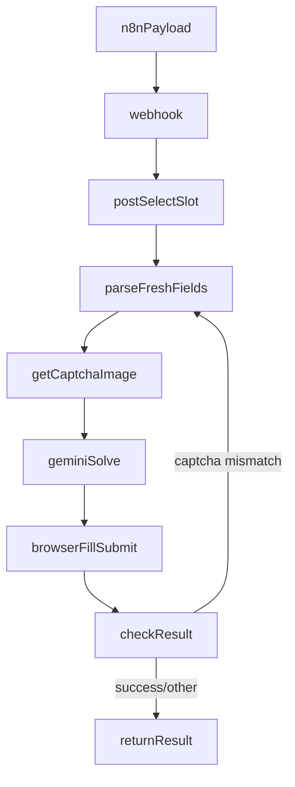

# Agent Project Documentation

## Project Identity

- **Project Name:** Python Booker Webhook (Non-Headless)
- **Location:** `python-booker-webhook`
- **Primary Entry Point:** `app.py`
- **Service Type:** FastAPI webhook service that automates the Austrian appointment booking captcha segment using Playwright + Gemini
- **Caller System:** n8n workflow (`Austria Booker — Workflow 2.json`)

## Scope and Objective

This project extracts and replaces the **captcha/session-sensitive booking segment** from n8n with a Python service.

### In Scope

- Accept booking payloads via HTTP webhook.
- Reuse appointment session/cookie provided by n8n.
- Reproduce slot-selection and booking form flow.
- Extract fresh captcha/session hidden fields from returned HTML on every attempt.
- Fetch captcha image and solve via Gemini API.
- Fill captcha and submit using a visible (non-headless) browser.
- Retry on captcha mismatch with fresh state.
- Return a structured result to caller.

### Out of Scope

- Full redesign of upstream n8n slot/student assignment logic.
- Database/data-table management.
- Authentication/token issuance for this webhook.
- Long-term hosting/deployment automation.

## Why This Was Built

The original n8n chain had recurring failures around captcha handling and state synchronization:

- Visual uppercase in captcha input did not always match true submitted value.
- Hidden captcha fields (`BDC_*`) rotate between attempts.
- Form action endpoint can change dynamically (`/HomeWeb/Appointment`, `/HomeWeb/AppointmentPassport`, etc.).
- Reusing stale fields/image/token across retries leads to server-side captcha mismatch.

The Python service centralizes this fragile logic into one deterministic flow and reduces node-level mismatch risk.

## What Was Implemented

## 1) Webhook Service

- Added FastAPI endpoint: `POST /webhook/booker`.
- Validates required payload fields:
  - `sessionCookie`, `Language`, `Office`, `CalendarId`, `currentMonday`, `currentSlot`, `student`.

## 2) Browser Automation (Non-Headless)

- Uses Playwright sync API with `headless=False`.
- Creates browser context and injects cookies parsed from `sessionCookie`.
- Keeps behavior visually inspectable for debugging.

## 3) Slot-Selection Request Recreation

- Recreates n8n `POST Select Slot` request to `/HomeWeb/Scheduler`.
- Sends form-urlencoded body with:
  - `Language`, `Office`, `CalendarId`, `PersonCount`, `Monday`, `Start`, `Command=Next`.
- Preserves required headers (`Cookie`, `Origin`, `Referer`, `User-Agent`, `Content-Type`).

## 4) Fresh State Extraction

From returned HTML, parser extracts:

- `form action` -> `bookingEndpoint`
- `Token`
- `StartTime`
- `BDC_VCID_Captcha`
- `BDC_Hs_Captcha`
- `BDC_SP_Captcha`
- `BDC_BackWorkaround_Captcha`

These values are treated as atomic attempt state and must be synchronized.

## 5) Captcha Handling

- Captcha image URL is built from fresh VCID:
  - `/BotDetectCaptcha.ashx?get=image&c=Captcha&t=<VCID>`
- Image bytes are sent to Gemini `generateContent`.
- OCR output is normalized via:
  - `strip().upper()`

This was an intentional decision based on observed UI behavior where displayed value appears uppercase while underlying input can remain mixed-case.

## 6) Form Fill + Submit

- Service loads HTML into browser (`page.set_content`) with injected base href.
- Fills applicant fields and selects drop-down values.
- Inserts captcha into `#CaptchaText`.
- Submits via `#nextButton`.

## 7) Result Classification + Retry

Result heuristics:

- `SUCCESS` when capture page markers are absent.
- `SLOT_TAKEN` when appointment-unavailable strings are detected.
- `CAPTCHA_FAIL` path retries with fresh fields.
- `OTHER_FAIL` for all remaining outcomes.

Retry count controlled by `maxCaptchaRetries` (default 3).

## Architecture and Data Flow



## File-Level Responsibilities

- `app.py`
  - Entire business flow: request recreation, parsing, captcha solve, browser submit, retry logic, response formatting.
- `requirements.txt`
  - Runtime dependencies (`fastapi`, `uvicorn`, `playwright`, `requests`, `python-dotenv`).
- `.env` / `.env.example`
  - Gemini config (`GEMINI_API_KEY`, `GEMINI_MODEL`).
- `README.md`
  - Quick setup and usage instructions.

## Environment and Configuration Notes

## Required

- `GEMINI_API_KEY`
- `GEMINI_MODEL` (default recommended: `gemini-2.5-flash`)

## .env Loading Behavior

The app explicitly loads `.env` from script directory:

- `load_dotenv(dotenv_path=Path(__file__).with_name(".env"))`

This avoids failures when `uvicorn` is started from different working directories.

## Known Pitfalls and Resolutions

## 1) `.env` not loaded

- Symptom: `"GEMINI_API_KEY is missing."`
- Fix: explicit dotenv path + install `python-dotenv`.

## 2) Gemini key invalid

- Symptom: `API_KEY_INVALID` from Generative Language API.
- Meaning: `.env` loaded but key/project config is invalid/restricted.
- Fix: generate valid key, ensure API enabled, remove incorrect restrictions.

## 3) DNS/public forwarding issues

- Symptom: curl cannot resolve forwarded host.
- Fix: verify forwarded URL availability, fallback to `http://127.0.0.1:8000` locally.

## Integration Contract for n8n

n8n should call:

- `POST http://<host>:8000/webhook/booker`

Payload should include full slot/session/applicant data as currently produced by workflow 2.

Recommended migration:

- Replace the old captcha chain nodes with one HTTP request to this webhook.
- Keep upstream student/slot queueing and downstream result handling in n8n.

## Validation Performed

- Syntax validation of Python app.
- Runtime verification that `.env` is loaded in app import path.
- End-to-end local webhook test reached `SUCCESS` in sample run.

## Design Decisions and Rationale

- **Non-headless browser:** chosen for visibility/debug confidence with captcha and UI state.
- **Fresh field parsing each attempt:** prevents stale `BDC_*`/token mismatch.
- **Uppercase captcha normalization:** aligns with observed uppercase visual behavior and reduces mismatch risk.
- **Webhook boundary:** keeps n8n simple and isolates fragile captcha/session logic in code.

## Next Recommended Improvements

- Add `/health` endpoint with safe diagnostics (env loaded, model configured, dependency checks).
- Add structured logging with request IDs for traceability.
- Add optional screenshot-on-failure artifact saving.
- Add automated tests for HTML parsing and result classification functions.

## Operational Commands

```bash
cd python-booker-webhook
python -m venv .venv
.venv\Scripts\activate
pip install -r requirements.txt
playwright install chromium
uvicorn app:app --host 0.0.0.0 --port 8000 --reload
```

## Agent Handoff Summary

If you are a future agent continuing this project:

1. Treat `app.py` as source of truth for captcha/session flow.
2. Preserve strict fresh-state extraction before each submit.
3. Avoid reintroducing stale field reuse across retries.
4. Verify Gemini key validity first when OCR-related errors appear.
5. Keep interface contract with n8n payload stable unless coordinated.
